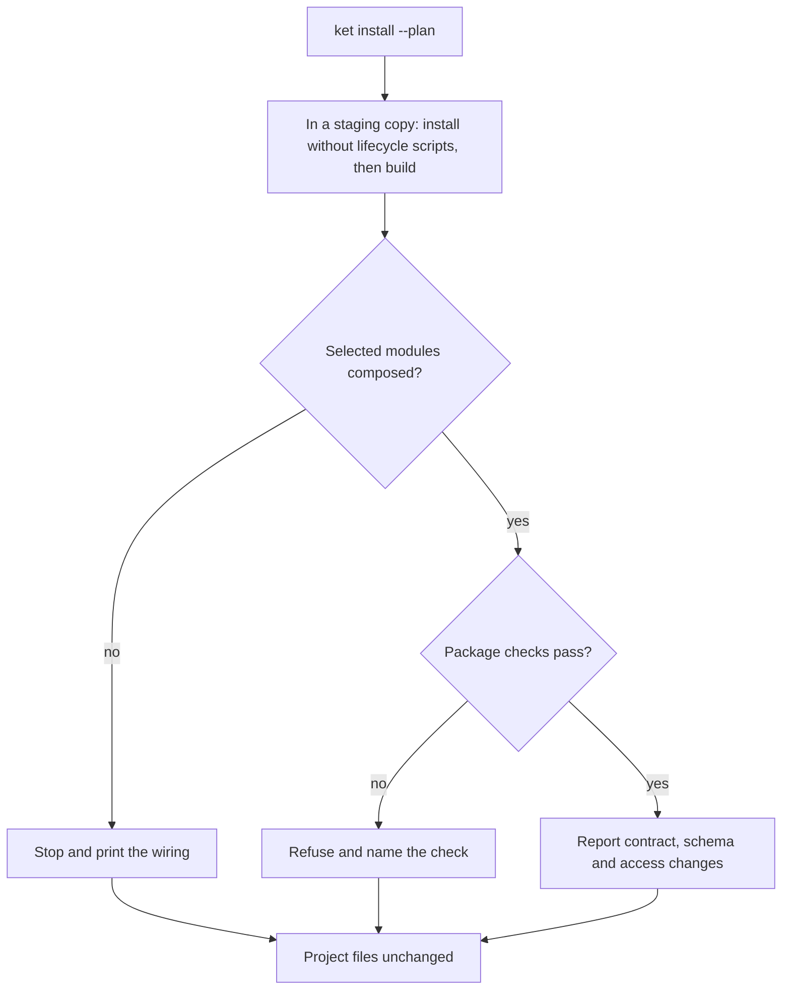
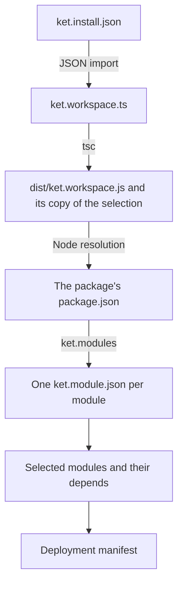
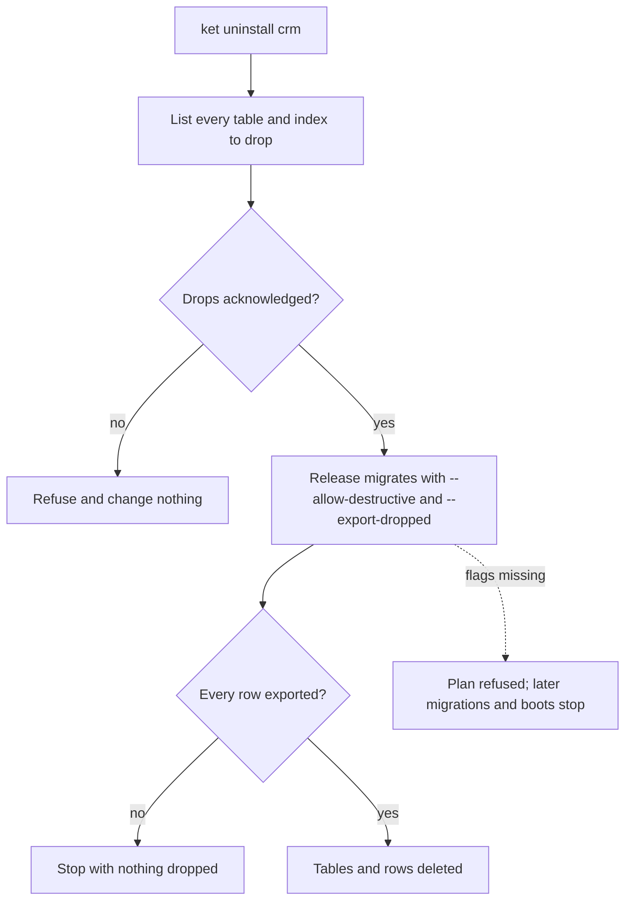
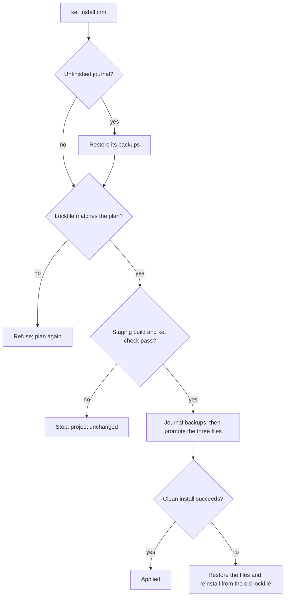
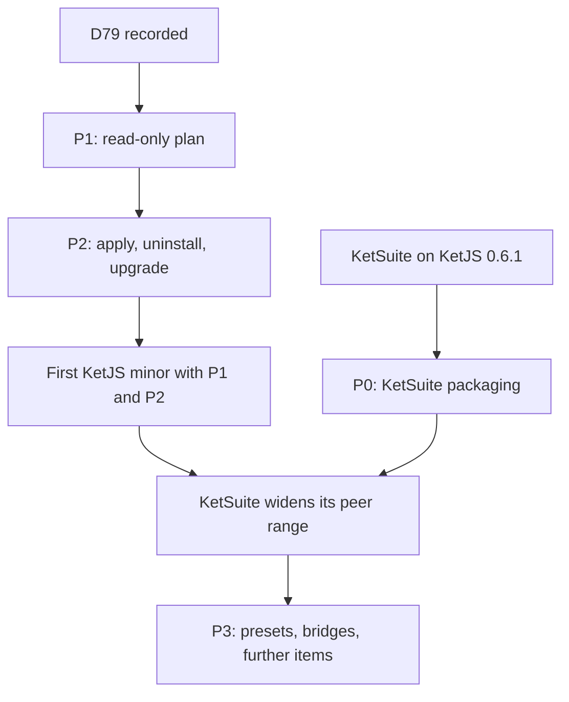

**Status: accepted in [D79](/docs/architecture-decisions/#d79-packaged-modules-enter-a-deployment-through-its-source), not built.** This page records the plan for `ket install` and the
contracts D79 settles. Nothing described here exists in the current release.

## Goal

Let an application add modules published as npm packages, starting with KetSuite modules such as
`user`, `product`, `stock`, `flow`, `website` and `crm`:

```bash
# Run from: /path/to/example-app
ket install product stock --from @ketvietlab/ketsuite@<version>
```

The command must keep every guarantee the framework already makes about composition, migrations and
access. It is a tool for the deployment owner at development time, not a runtime feature.

## Constraints

These existing decisions and behaviors shape the design and are not reopened by it:

- [D67](/docs/architecture-decisions/#d67-deployment-composition-replaces-the-module-application-lifecycle):
  `DeploymentSpec.modules` is the only composition list. There is no runtime install state, no App List
  screen, and every tenant of a deployment receives the same manifest. KetJS removed an earlier module
  lifecycle with runtime installs and self-installing bridges; this plan does not restore it.
  `ket install` edits source and dependencies, and a change takes effect only after a build and release.
- [D50](/docs/architecture-decisions/#d50-module-paths-discover-packages-they-do-not-decide-the-deployment)
  and [Module discovery](/docs/module-discovery/): `ket.module.json` holds only `name` and `entry`.
  Version and dependencies stay in `defineModule()`, the resolver computes the dependency closure, code is
  imported only when a module is selected, and duplicate module names fail regardless of root order.
  Discovered code is trusted server code, not a sandbox.
- [D7](/docs/architecture-decisions/#d7-destructive-migrations-are-generated-but-refused): a migration plan
  that contains any destructive operation, such as `DROP_TABLE`, `DROP_COLUMN` or `DROP_INDEX`, is refused
  as a whole unless `--allow-destructive` is passed. Servers and workers migrate on boot unless
  `KET_MIGRATE=0`, so a refused plan also stops them from starting.
- The CLI loads the built workspace, `dist/ket.workspace.js` first. Source changes are invisible to it until
  the project is built again.
- The framework does not know about KetSuite, its CLI has no runtime dependencies, and framework CI does
  not depend on KetSuite. KetSuite is the first source of modules, not a special case.

## Defaults

| Question | Default | Reason |
| --- | --- | --- |
| Approach | Any package that ships module roots can be installed; KetSuite is the first such package | Keeps the framework independent of KetSuite and reuses the existing resolver |
| Sources | Only the `@ketvietlab` scope, and only versions published with npm provenance, until a source allowlist exists | Scope ownership plus provenance ties a package to its repository and build |
| Where the selection lives | A data file owned by the CLI, `ket.install.json` | Rewriting TypeScript reliably needs a parser; the name stays distinct from the `ket.module.json` descriptor |
| Command names | `ket install` and `ket uninstall` | The verb developers already use for packages; neither command runs in production |

## Contracts

[D79](/docs/architecture-decisions/#d79-packaged-modules-enter-a-deployment-through-its-source) records these five contracts, and P1 and P2 implement them. A plan touches the project only
through a staging copy:



### C1: package and deployment selection

- The first install from a package names it with an exact version: `--from <package>@<version>`. A
  module name alone resolves only against packages already recorded in `ket.install.json`; a name that
  more than one recorded package provides is refused.
- `--deployment <name>` is required when the workspace has more than one deployment.
- A workspace has one installed version per package. Installing, upgrading or removing a package
  therefore reports every deployment that selects a module from it, not only the deployment named on the
  command line.
- `ket uninstall` removes a module from one deployment's selection. The package leaves `package.json` only
  when no deployment selects any module from it.

### C2: building the candidate

- Plans and checks never read existing build output. They copy the project into a staging directory,
  apply the candidate selection there, run the project's own build script, and load the workspace that
  build produced.
- After composing the candidate, every selected module must appear in its deployment's manifest. If one is
  missing, the workspace does not consume `ket.install.json`; the command stops before changing anything
  and prints the lines to add.
- A project without a build script that produces the workspace artifact is refused with the same
  instructions.
- The workspace imports `ket.install.json` with `with { type: 'json' }`, and `tsconfig.json` sets
  `resolveJsonModule` and includes the file, so `tsc` copies it into `dist`. The selection is part of the
  build artifact, as D67 requires; the [spike](#spike-results) explains the choice.
- Package roots are found by Node resolution of `<package>/package.json`, never by relative paths, so the
  same workspace resolves them from source and from `dist`.



### C3: what the report compares

The report has three separate parts, each with a stated baseline:

1. **Contract changes.** The current workspace's manifest compared with the candidate's, using the same
   comparison as `ket diff`. This includes breaking changes and the `BUNDLE_WIDENED` and
   `ROLE_TEMPLATE_WIDENED` diagnostics.
2. **Schema migration.** The schema of the current manifest compared with the candidate's, using the same
   planner as `ket migrate --dry-run`. New tables and every destructive operation, index drops included,
   are listed. A physical database can differ from the current manifest; `ket schema verify` remains the
   check against a real database.
3. **Access.** New functions, new anonymous functions reachable without a grant, and role templates or
   bundles that a package upgrade widens. The installer never writes grants, but these changes can widen
   effective access without one, so the report shows them instead of promising that nothing is granted.

### C4: removal and retained data

Removing a module removes its models from the manifest, so the next migration contains `DROP_TABLE`.
Because that plan is refused as a whole, every later migration of the deployment, every tenant included,
stops, and so do servers and workers that migrate on boot. Keeping the tables while migrations continue
is not possible with the current schema planner.



`ket uninstall` therefore means export and then drop:

- the plan lists every table, column and index that will be dropped;
- applying requires an explicit acknowledgement of those drops;
- the release that ships the removal runs `ket migrate --allow-destructive --export-dropped <directory>`;
- the page that documents the command says plainly that the data is deleted.

`--export-dropped` is a new `ket migrate` option. `ket uninstall` cannot export the data: it runs in the
developer's project, while the rows live in each deployed datastore, and the migration that drops them is
the only step that reads them.

- It writes every row of each table about to be dropped, and the key and value of each column about to be
  dropped, as one JSON Lines file per table in the directory the operator names.
- It finishes the export and compares the written row counts with the tables before the first `DROP`. A
  failed or incomplete export stops the migration with nothing dropped.
- With `--all`, each datastore writes its own files, so one datastore's rows never share a file with
  another's.
- When a plan drops the tables or columns of a module that is no longer composed, `--allow-destructive`
  alone is refused. The operator passes `--export-dropped <directory>`, or states `--no-export` to drop
  without a copy. Other destructive operations keep today's behavior.
- The files hold production data, often personal data. Where they are stored and when they are deleted is
  the operator's responsibility, and the documentation of the option says so.

Retaining detached tables, so that the schema comparison skips them and migrations continue, would
change D7 and `ket schema verify`. It needs its own decision record and is not part of P2.

### C5: apply, recovery and version pinning

- **One resolution.** The plan installs into staging once. Applying reuses that staging lockfile and never
  resolves versions again. A separate apply after a saved plan is refused if the lockfile hash, a package
  version or its integrity differs from the plan.
- **Promote only what passed.** Applying installs the dependencies in staging under the project's own
  script policy, builds the candidate and runs `ket check` there. Only after that passes does it copy
  `package.json`, the lockfile and `ket.install.json` into the project and run a clean install from that
  lockfile, the same as `npm ci`.
- **Restore the tree, not only files.** If the clean install fails, the three files are restored and the
  project is installed cleanly again from the restored lockfile, so `node_modules` matches the lockfile on
  disk.
- **Interruption.** A journal under `.ket/install/` records the backups before promotion. The next
  `ket install` finds an unfinished journal and restores the backups before doing anything else.
- **Limits.** Effects of lifecycle scripts outside `node_modules`, such as files written elsewhere or
  network calls, cannot be undone. The report names every package that runs an install script.



## Selection file

`ket.install.json` records only the modules a deployment selects directly. The resolver derives their
dependencies, so `ket uninstall` can tell which modules were pulled in only by the one being removed.

```jsonc
// File: example-app/ket.install.json
{
  "packages": { "@ketvietlab/ketsuite": "<version>" },
  "deployments": {
    "app": ["crm", "product"]
  }
}
```

The workspace combines it with its own declarations:

- The candidate deployment's modules are the workspace's own references followed by the selected names.
  Order carries no precedence, because composition sorts modules by dependency.
- A name that the workspace already provides, inline or by string, is refused, as the resolver already
  refuses one name supplied twice.
- Package roots are appended after the workspace's `modulePaths`. A module name provided by two roots fails
  as it does today.
- A deployment named in the file but absent from the workspace is refused.

Presets and bridges come from the package's data and never appear in the file as such:

- A preset, such as `crm` with its screens, is expanded into explicit module names when it is installed.
  A later package version that adds a module to the preset does not add it to the file; the upgrade report
  names it.
- A bridge is a module the package declares as joining two or more modules. When every module it joins is
  selected for a deployment, `ket install` adds the bridge to that deployment's list and the report says
  why. Uninstalling any module it joins removes the bridge as well, and the bridge's tables follow C4.

## Spike results

A throwaway spike on 2026-10-24 used a project created by `ket new` with KetJS 0.6.1 from npm, Node 26.7
and npm 11.19 on macOS, a fixture package with two modules, and the published `@ketvietlab/ketsuite`
0.1.41. Nothing was changed in this repository.

**Resolution already works.** With the fixture's root in `modulePaths` and one module selected by name,
the current resolver added its dependency, `ket check` passed, and `ket migrate --dry-run` planned only
`CREATE TABLE`. P0 alone is therefore usable without a framework change.

**Wiring.** Three ways for the workspace to consume the selection were built with the project's `tsc`:

| Way | Selection in `dist` | Change seen without a rebuild | Works when only `dist` is deployed |
| --- | --- | --- | --- |
| JSON import emitted by `tsc` | yes | no | yes |
| TypeScript module written by the CLI | yes | no | yes |
| JSON read from disk when the workspace loads | no | yes | no, the file is outside the artifact |

The first is chosen. The third keeps composition outside the build artifact, against D67. Staleness is
handled by C2, which always builds the candidate. None of the three added type errors.

**Relative roots break in one mode.** A root such as `../node_modules/...` resolves from the workspace
file, which sits in the project root in source mode and in `dist` after a build, so one of the two modes
fails with `E_MODULE_PATH_MISSING`. Resolving `<package>/package.json` through Node worked in both modes,
but fails with `ERR_PACKAGE_PATH_NOT_EXPORTED` when a package declares `exports` without
`./package.json`. The published KetSuite package is such a package.

**Generated code assumes module objects.** With a module selected by name, the scaffold's
`tools/openapi.ts` and `test/deployment.test.ts` no longer type-check, because they pass the declaration
straight to `compose()` and `createTestDeployment()`. Both must resolve the workspace first.

**Company scope reaches the application.** KetSuite modules need `companies: true`, and with it every
model of the application must declare a scope; the scaffold's own model failed with `E_MODEL_NO_SCOPE`.
Installing KetSuite therefore requires source changes the installer must not make.

**Two framework copies pass composition and fail at runtime.** The published KetSuite 0.1.41 depends on
`@ketvietlab/ketjs` 0.2.0 and `@ketvietlab/ketjs-view` 0.2.0, so the project held two copies of each.
After scoping the model and adding the missing `./package.json` export by hand, `product` and `uom`
composed with 28 warnings and `ket check` reported no errors. A call to `product.listAttributes` then
failed with `E_INTERNAL`: its handler used the query helpers of the nested 0.2.0 copy on columns created by
the 0.6.1 kernel. The application's own function in the same deployment succeeded. A passing check is
not evidence that a package is safe; the singleton check must refuse it.

**Install scripts and native code.** npm 11.19 reported the install scripts of `esbuild` and `fsevents`
as not approved; `sharp` 0.35.5 declares none. Both `sharp` and `esbuild` loaded and worked from their
prebuilt packages. Other platforms were not tested.

**Staging cost.** For this small project, with KetSuite added: copying the project without dependencies
took milliseconds, `npm ci` took 5.8 s with a warm cache and 6.9 s with an empty one (62 MB downloaded),
the build took 0.6 s, and an APFS clone of the whole project with its 205 MB of dependencies took 1.7 s.
Large workspaces were not measured.

## Phases

### P0: KetSuite can be installed as a package

KetSuite work, independent of the framework phases, done after KetSuite moves to KetJS 0.6.1.

1. Declare `@ketvietlab/ketjs` and `@ketvietlab/ketjs-view` as `peerDependencies` with the same range.
   Before 1.0 a minor release is breaking, so the range covers one minor, for example `>=0.7.0 <0.8.0`; a
   caret range on 0.6 would not accept 0.7. Publish a new version built against the current KetJS: the
   published 0.1.41 still depends on KetJS 0.2.0 and fails at runtime in a current application.
2. Export `./package.json`, so the package root can be found through Node resolution.
3. Generate `dist/modules/<name>/ket.module.json` for every module during the build, with a test that each
   descriptor name equals the module's `defineModule()` name. The published tarball already places each
   module at `dist/modules/<name>/index.js`.
4. Add `"ket": { "modules": "./dist/modules" }` to the package manifest.
5. Load native dependencies such as `sharp` and `ioredis` lazily, so domain modules like `product` do not
   require them.
6. Clear the `E_FN_EFFECT_NOT_DEPENDED` warnings that a minimal composition reports, so `product` with `uom`
   composes cleanly.
7. Publish with npm provenance, and document manual use with the current framework: install the package,
   add the root to `modulePaths`, enable `companies: true`, scope the application's own models, and select
   modules by name.

Done when a project created by `ket new` with the KetSuite tarball shows one copy each of
`@ketvietlab/ketjs` and `@ketvietlab/ketjs-view` in `npm ls`, `ket modules` resolves `product` with
`uom`, `ket check` reports no errors or warnings, `ket migrate --dry-run` only creates tables, and a call
to a `product` function through `/_ket/fn` succeeds.

### P1: a read-only plan

1. `modulePaths` accepts `{ package: name }`. The resolver finds the package's `package.json` with Node
   resolution from the workspace, reads `ket.modules`, and refuses a root outside the package.
2. `ket install --plan` builds the candidate as C2 describes, with lifecycle scripts disabled, and prints
   the three-part report from C3 together with package versions, integrity, provenance and install
   scripts.
3. The plan refuses more than one copy of `@ketvietlab/ketjs` or `@ketvietlab/ketjs-view`, a KetJS version
   outside the package's peer range, mismatched peer ranges for the two, missing provenance and any source
   outside the allowed scope.
4. Document package roots in Module discovery and CLI configuration, add an installation guide, and list
   the change in Upgrading.
5. Test with a fixture package in a temporary `node_modules`, never with KetSuite.

P1 acceptance cases:

- a stale build artifact in the project does not change the report;
- a fresh project without build output still gets a report;
- an unwired workspace stops before any file changes;
- a plan leaves every project file byte-identical;
- root escape, duplicate framework copies, version ranges, missing provenance and sources outside the scope
  are refused;
- a package that brings its own framework copy is refused even though its composition passes;
- a package whose `exports` omit `./package.json` is refused with a message that names the missing export.

### P2: apply, uninstall and upgrade

1. Apply as C5 describes, wire `ket.install.json` into workspaces generated by `ket new`, and print the
   wiring for existing workspaces instead of editing them. The generated `tools/openapi.ts` and deployment
   test resolve the workspace before composing, so they keep working when modules are selected by name.
2. When an installed module needs `companies: true`, the plan lists the application's models that must
   declare a scope and stops; it never edits them.
3. `ket uninstall` as C4 describes, together with `ket migrate --export-dropped` and `--no-export`.
4. `ket install --upgrade` plans a newer package version across every deployment that uses it and links
   the source's release notes. Automatic code migrations are out of scope.
5. Ship together with P1 in the first minor release after both are done, through the VERSION and
   CHANGE_LOG gates; other releases do not wait for them. The release check gains an install smoke test that
   uses the fixture package and calls one installed function at runtime.

P2 acceptance cases:

- a failing `ket check` after an install script ran leaves the files unchanged and `node_modules` matching
  the lockfile on disk;
- an apply interrupted during promotion is restored by the next run;
- an apply after a saved plan is refused when a newer version would resolve;
- uninstalling from a database with rows lists the tables, refuses without the acknowledgement, and drops
  them only through a migration run with `--allow-destructive` and `--export-dropped`, after the files hold
  every row;
- an export that fails or writes fewer rows than the table holds stops the migration with every table
  intact;
- `--allow-destructive` alone is refused for a removed module's tables, and `--no-export` drops them
  without a copy;
- with `--all`, each datastore's rows are written to its own files;
- a package used by two deployments: an upgrade reports both, and uninstalling from one keeps the package.

### P3: extensions

1. **Presets and bridges, decided in [D79](/docs/architecture-decisions/#d79-packaged-modules-enter-a-deployment-through-its-source).** KetSuite declares presets, such as CRM with its
   screens, and bridges, such as a module that joins CRM and mail, as data in its package manifest.
   `ket install` expands presets and adds bridges as the selection file rules describe. No module installs
   itself, and nothing is resolved at runtime.

   ```jsonc
   // File: example-package/package.json
   {
     "name": "@example/suite",
     "ket": {
       "modules": "./dist/modules",
       "presets": { "crm": ["crm", "crm_backend"] },
       "bridges": { "crm_mail": ["crm", "mail"] }
     }
   }
   ```

   The remaining items each need their own decision record.
2. **Server wiring.** KetSuite exports a helper for the `serve` configuration its modules need, and the
   plan shows what to add. The framework does not edit `serve`.
3. **One identity source per deployment.** Reject a composition that contains two user models used for
   sign-in, such as the authentication starter's `auth.User` and KetSuite's `user.User`.
4. **Third-party sources.** A `sources` allowlist in `ket.install.json`, empty by default.
5. **Retained tables.** The alternative to C4's export-and-drop, if a decision record accepts it.

## Risks

| Risk | Mitigation |
| --- | --- |
| Planning imports module code | Only in staging, with lifecycle scripts disabled and only from allowed sources; documented as trusted server code |
| Disabled install scripts break a native dependency during planning | `sharp` and `esbuild` loaded without scripts on macOS; P0 still makes native dependencies lazy, and the plan reports an import failure instead of guessing |
| A package brings its own framework copy, composes, and fails at runtime | The singleton check refuses it before anything is written; the release smoke test calls an installed function |
| KetSuite and KetJS versions drift | Peer ranges checked before anything is written; KetSuite releases against each KetJS minor |
| A removal blocks every later migration | C4 makes removal an explicit, exported drop instead of a silent block |
| Export files hold production data | Written only to the directory the operator names; the option's documentation states the retention duty |
| Bridges grow a deployment's composition | Each addition is written to `ket.install.json` and shown in the plan before it applies |
| Script effects outside the dependency tree | Reported per package; not undone |
| Enabling `companies: true` on a datastore with rows | The plan reports the requirement and never changes it |
| The KetSuite tarball is large (8.9 MB packed) | Accepted in P0; split packages only when measurements justify the release cost |
| Maintenance load of many small packages | Keep one coordinated KetSuite package |

## Order

1. P0 in KetSuite, after it moves to KetJS 0.6.1. KetSuite 0.1.42 makes that move without P0, so P0
   ships in a later KetSuite version.
2. The decision record for C1 to C5, export-and-drop, presets and bridges: [D79](/docs/architecture-decisions/#d79-packaged-modules-enter-a-deployment-through-its-source), recorded.
3. P1 and P2 in KetJS, released together in the first minor release after both are done.
4. KetSuite widens its peer range to that release.
5. P3: presets and bridges as D79 decides; every other item with its own decision record.

The dependencies between these steps:



## Prior art

| System | What happened | Lesson applied |
| --- | --- | --- |
| [Frappe](https://docs.frappe.io/cloud/common-issues/incompatible-app-version) | Apps must match the framework's major branch, and a mismatch breaks installation | Check version ranges before writing |
| [Spree and Solidus](https://solidus.io/blog/forking-spree-solidus-two-years-later) | Extensions patched internals and broke on upgrades; the fork prioritised upgradability | Extend through published contracts only |
| [Medusa](https://medusajs.com/blog/v2-release) | Version 2 isolated modules and removed cross-module foreign keys after painful upgrades | Keep module boundaries explicit |
| [Salesforce packages](https://developer.salesforce.com/docs/platform/pkg1-dev/guide/packaging-managed-component-deletion.html) | Removing a component deprecates it in subscriber orgs instead of deleting it | Make data loss on removal explicit, never incidental |
| [WordPress](https://patchstack.com/whitepaper/2025-mid-year-vulnerability-report/) | One-click installs grew a huge ecosystem, and plugins carry most of its vulnerabilities | Allow trusted sources first |
| [Drupal Recipes](https://www.drupal.org/about/starshot/initiatives/recipes) | Distributions chosen at project start were hard to update, add later or remove | Install into a running project, not at creation |
| [Django](https://docs.djangoproject.com/en/dev/ref/applications) | Reusable apps must not define their own user model | One identity source per deployment |
| [Laravel](https://laravel.com/docs/packages) and [Backstage](https://backstage.io/docs/frontend-system/building-apps/installing-plugins) | Packages declare what to register, and the application can opt out | Read declarations as data |
| [magicast](https://github.com/unjs/magicast) | Automated config edits only cover "static-ish" code and may throw | Do not rewrite TypeScript |
| [Angular `ng update`](https://angular.dev/cli/update) | Versioned migrations make upgrades routine | Plan upgrades with every version |
| [npm scripts](https://docs.npmjs.com/cli/using-npm/scripts) and [pnpm 10](https://newreleases.io/project/npm/pnpm/release/10.0.0) | Lifecycle scripts run during install; pnpm now disables dependency scripts by default | Never run scripts while planning; restore the tree, and name what scripts ran |
| [Shai-Hulud](https://www.invicti.com/blog/web-security/shai-hulud-2-worm-supply-chain-attack-on-npm-dependencies) | An install script spread a credential-stealing worm across hundreds of packages | Require provenance and a trusted scope |
| [Two copies of React](https://dev.to/r9v/the-two-reacts-bug-when-packages-arent-singletons-492h) | A library that bundles its framework breaks the application silently | Framework packages as peers, checked as singletons |

## Decisions

Maintainers settled the open decisions on 2026-10-25:

1. The defaults above stand, including `ket.install.json` and the names `ket install` and `ket uninstall`.
2. C1 to C5 are recorded as [D79](/docs/architecture-decisions/#d79-packaged-modules-enter-a-deployment-through-its-source). `ket uninstall` means export and then drop, and
   `ket migrate --export-dropped` performs the export.
3. P1 and P2 ship together in the first minor release after both are done; other releases do not wait.
4. Presets are package data that the CLI expands. Bridges are added to a deployment's selection when every
   module they join is selected.
5. KetSuite starts P0 after it moves to KetJS 0.6.1.

## Basis and limits

This plan is based on the framework's resolver, migration planner, boot sequence, CLI, scaffold and
decision records, and on the published `@ketvietlab/ketsuite` 0.1.41 tarball: 106 module directories under
`dist/modules`, 8.9 MB packed, and `product` depending only on `uom` in its source. The
[spike](#spike-results) exercised resolution, wiring, native dependencies without install scripts and
staging cost on one small project. No `ket install` code exists. Linux and Windows, pnpm and Yarn
projects, and the staging cost of a large workspace have not been tested.
