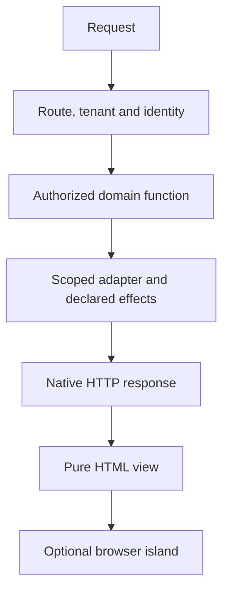

## Before the first request

KetJS resolves the selected deployment's module graph and checks its composed manifest. Routes, functions, models, jobs and presentation contracts come from that same composition. Read [Application composition](/docs/workspaces/) and [Modules](/docs/modules/) first.

## Resolve the request context

The HTTP runtime matches a native route and resolves the request's deployment, tenant and viewer context. Applications with multiple physical tenant databases must choose the tenant before opening tenant-scoped runtime state. Session-backed and externally resolved identities must keep their source explicit.

## Execute declared behavior

A route uses public domain functions under the viewer's permissions. Functions validate input, enforce declared effects and operate on the selected data scope. Business mutations and validation belong here rather than in a presentation island.

## The order of checks

Every request passes the same gates in this order. A later gate never runs for a request an earlier
one refused, so a caller who may not call a function learns that and nothing about its input.

| Step | Applies to | Refusal |
| --- | --- | --- |
| 1. Request target and `Host` | Every request | `400 E_INVALID_REQUEST_URL` for an absolute-form target or a host with userinfo |
| 2. Static asset mounts | Paths under a mount | `404` when the file is absent |
| 3. `serve.rateLimit` policy | Requests the policy names | `429 E_RATE_LIMITED` with `retry-after` |
| 4. Function exposure | `/_ket/fn/*` | `400 E_FUNCTION_INTERNAL`, `403 E_FUNCTION_BOUND` |
| 5. Body size and shape | `/_ket/fn/*` and bindings | `413 E_PAYLOAD_TOO_LARGE`, `400 E_INVALID_JSON_BODY` |
| 6. Cross-site boundary | Session-authenticated writes | `403 E_HTTP_CSRF`, `415 E_HTTP_CONTENT_TYPE` |
| 7. Tenant and identity | Every route that reads data | `400 E_UNKNOWN_TENANT`; `401` for a binding that requires sign-in |
| 8. Permission | Function calls | `403 E_FN_NOT_PERMITTED` |
| 9. Existence and input | Function calls | `404 E_UNKNOWN_FUNCTION`, `400 E_INVALID_INPUT`, `422` for a binding schema |
| 10. Dry run and idempotency | Function calls | `400 E_NO_DRY_RUN`, `E_NOT_IDEMPOTENT`, `E_IDEMPOTENCY_CONFLICT` |
| 11. Handler, effects and output | Function calls | Business codes; a deployment defect answers `500 E_INTERNAL` |

## Return a native response

A handler returns the appropriate HTTP response, redirect, stream, form outcome or HTML. Shared views render pure markup. Explicit islands hydrate that markup and own browser state and effects. Native links and forms retain their ordinary fallback behavior.

## Continue by responsibility

Read [HTTP routes](/docs/http/) for routing and responses, [Authorization](/docs/authorization/) for access, [Sessions and tenant isolation](/docs/sessions-tenants/) for identity, and [Rendering and islands](/docs/rendering/) for presentation.
