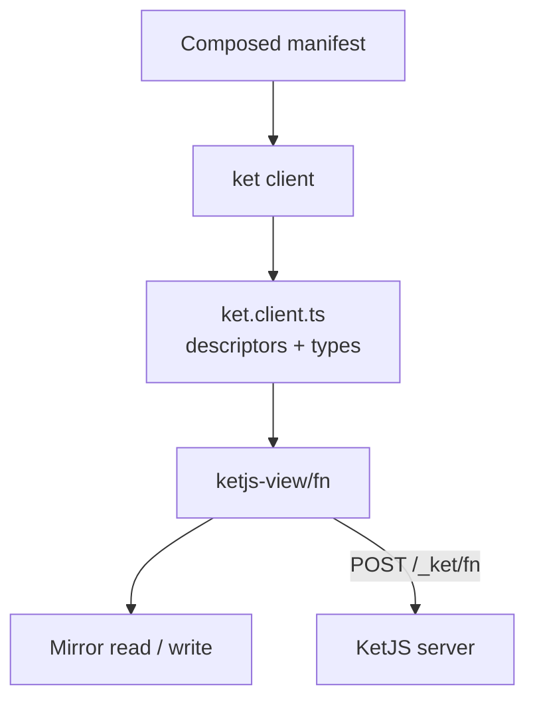

**Status: proposed in [D83](/docs/architecture-decisions/#d83-a-function-client-for-mirror-generated-from-the-manifest), not built.**
This page records the plan for `@ketvietlab/ketjs-view/fn` and `ket client`. Nothing described here exists
in the current release.

## Goal

An island that reads or writes through a KetJS function today writes its own `fetch()` and its own
parser:

```ts
// File: src/client/orders.ts
export const orders = mirror.read({
  key: () => ['orders', { status: status() }] as const,
  load: ([, filter], { signal }) =>
    fetch('/_ket/fn/sales.listOrders', {
      method: 'POST',
      credentials: 'same-origin',
      signal,
      headers: { 'content-type': 'application/json' },
      body: JSON.stringify(filter),
    }).then(async (response) => {
      const body = await response.json()
      if (!response.ok || body.ok !== true) throw new Error(`listOrders: HTTP ${response.status}`)
      return body.value
    }),
  parse: parseOrders, // written by hand, kept in step with the function's output by hand
  tags: () => ['orders'], // chosen by hand, matched by every writer by hand
})
```

Each piece already exists in the manifest: the function's name, its input and output fields, how many rows it
returns, whether it is idempotent, and which models it reads and writes. The goal is to use them:

```ts
// File: src/client/orders.ts
import { fnRead, fnWrite } from '@ketvietlab/ketjs-view/fn'
import { mirror } from './mirror.ts'
import { sales } from './ket.client.ts'

export const orders = fnRead(mirror, sales.listOrders, {
  input: () => ({ status: status() }),
  keepPrevious: true,
})

export const createOrder = fnWrite(mirror, sales.createOrder)
// await createOrder.run({ id, number, total }) reloads every observed reading of sales.Order
```

## Constraints

These decisions and behaviors shape the design and are not reopened by it:

- [D81](/docs/architecture-decisions/#d81-mirror-server-state-is-a-cache-on-signals-with-no-transport-of-its-own):
  Mirror has no transport of its own and stays backend-agnostic. The client is a separate subpath that builds
  ordinary `load` and `run` functions for Mirror. Mirror does not import it and does not change.
- ketjs-view is browser-safe and does not depend on `@ketvietlab/ketjs`. The client cannot import a module's
  `FnSpec`; everything it knows about a function arrives as generated data.
- [The generic transport](/docs/functions/#the-generic-transport) keeps every boundary it has. Permissions,
  tenant scope, CSRF, `internal` exposure and identity-bound inputs are enforced by the server. The client adds no
  authority and cannot remove a check.
- Native forms and server-rendered pages remain the default data path. The client serves islands and
  client-rendered screens that already use Mirror.
- A Mirror that holds answers depending on the user must set `scope`. The client does not know who is signed in
  and does not replace that boundary.

## What the server already guarantees

These facts were checked in the source and decide several contracts below:

| Fact | Where |
| --- | --- |
| `POST /_ket/fn/<module>.<function>` answers `{ ok, value, dryRun }`, plus `replayed` on an idempotent replay. | `packages/ketjs/src/server/http.ts` |
| The value is projected: only declared `output` fields leave the server, and a declared `returns` is enforced. | `packages/ketjs/src/server/project.ts` |
| An `idempotency-key` on a function not declared `idempotent` is refused with `E_NOT_IDEMPOTENT`. | `packages/ketjs/src/server/fn.ts` |
| A `transactional` function requires an idempotency key. | `packages/ketjs/src/server/fn.ts` |
| A function binding spells a `decimal` computed as a number as its exact text and a `Date` as its ISO instant. The generic transport does not. | `packages/ketjs/src/server/http-binding.ts` |
| `ket types` already emits `KetFunctions` with input and output types. It ignores `returns`, so a `many` function is typed as one row. | `packages/ketjs/src/codegen/dts.ts` |
| `allowFor` decides per request, from the database. It cannot be evaluated when a bundle is built. | `packages/ketjs/src/server/boot.ts` |

## Architecture



- **`ket client`** reads the composed manifest and writes one TypeScript file of function descriptors. A
  descriptor is data: name, kind, `returns`, output field types, idempotency and default tags, with input and
  output types attached.
- **`@ketvietlab/ketjs-view/fn`** turns a descriptor into a transport call, a parser and Mirror options. It has
  no dependency on `@ketvietlab/ketjs`.
- **Mirror** is unchanged. `fnRead()` and `fnWrite()` return the same readings and writers as `mirror.read()` and
  `mirror.write()`.

## Contracts

### C1: transport

`fnClient({ fetch?, base? })` owns one request shape:

- `POST {base}/_ket/fn/{encodeURIComponent(name)}` with a JSON object body and `credentials: 'same-origin'`, which
  is what the CSRF rule of the generic transport expects from a browser.
- `idempotency-key` is sent only for a descriptor declared `idempotent`. Mirror's `idempotencyKey` stays the same
  across the retries of one `run()`, so it is the key that is sent.
- A response with `ok: true` resolves to `value`. Anything else throws `FnError` with `status`, `code`,
  `message`, `issues` and the `x-request-id` header as `requestId`. `hint` and `at` are not read, because they
  are null outside development.
- `formActionTransport()` moves onto the same transport. Its behavior does not change: a `422` with issues is
  still an `invalid` outcome, and any other refusal still throws without resetting the draft.

A dry run is not part of the first version. `?dryRun=1` stays available to `ket call` and tests.

### C2: which functions are generated

```bash
# Run from: /path/to/example-app
ket client --deployment web --include 'sales.*,catalog.listProducts' --out src/client/ket.client.ts
ket client --deployment web --include 'sales.*,catalog.listProducts' --out src/client/ket.client.ts --check
```

- **The selection is explicit.** `allowFor` is evaluated per request, so a build cannot know which functions a
  user may call. The generated file is part of a public bundle and names every function it lists, while the
  generic transport deliberately never lists names to a stranger. Only the functions a bundle needs belong in it.
- **Refused, with a reason per function:** an `internal` function, a function whose binding fills an input from
  identity (the transport answers `E_FUNCTION_BOUND`), and a function without a declared `returns`. The last
  follows the binding rule: a contract cannot be generated from a guess.
- **`--check`** exits non-zero when the file differs from what the manifest would produce, for CI.

### C3: kind

- **`read`:** every declared effect is a `read:` effect, or there are none. Only a read descriptor can be passed to
  `fnRead()`. The type refuses the other kind, and so does the runtime for an untyped caller.
- **`write`:** any other effect: `write:`, `enqueue:`, `storage:` or `transport:`. Only `fnWrite()` accepts it,
  so a mutation cannot be cached or deduplicated as a read by mistake.

Effects are enforced on the server, so a read descriptor cannot hide a write.

### C4: types and parsers

- **Types** use the mapping `ket types` already applies: `id`, `text`, `ref:*`, `decimal`, `date` and `datetime`
  are strings; `int` and `float` are numbers; `bool` is a boolean; `json` is `unknown`. A `?` field may be
  absent or null.
- **`returns`** shapes the value: `one` is a row, `optional` a row or `null`, `many` an array of rows and `none`
  is `null`. `KetClient` in `ket types` gains the same shaping in the same phase, so the two never disagree.
- **The parser is built at runtime from the descriptor**, not generated as code. It checks the shape that
  `returns` promises and every declared field against its type, and it copies only declared fields into a new
  object. A violation makes the Mirror load `failed`, as any parse error does.
- **A `decimal` may arrive as a number.** The generic transport does not spell decimals the way bindings do, so
  the parser accepts a finite number and converts it with the binding rule. Changing the server to always
  answer text would change what existing callers receive. It is listed under [Decisions](#decisions).

### C5: keys and tags

- **Key:** `['fn', name, input]`. Mirror already sorts object properties, so the same input is the same entry.
  A `null` from `input()` disables the read, as a `null` key does.
- **Default tags come from effects.** A read with `read:sales.Order` is tagged `sales.Order`. A write with
  `write:sales.Order` invalidates `sales.Order` after success, which reloads every observed reading of that
  model and marks the others stale. Nobody has to remember to name a tag twice.
- **Options add to the defaults.** `tags: (input) => [...]` and `invalidates: (input, value) => [...]` add
  finer tags, such as one record. `defaultTags: false` turns the derived ones off.
- **`optimistic`** is passed to `mirror.write()` unchanged.

Model tags are coarse on purpose: a write to one order reloads every observed list of orders. A screen that
needs less can add record tags and turn the defaults off.

### C6: server render and hand-off

A server render creates a mirror per request. It should not call its own server over HTTP. The server package
adds an in-process loader that runs the function with the request's scope, allow list and actor and applies the
same projection. Readings use the same key on both sides, so `snapshot()` and `restore()` line up without any
glue.

### C7: build skew

Every answer carries `x-ket-build`. The generated file records the build it was produced from. On a mismatch
the client calls an `onSkew` callback once. It never reloads the page on its own.

## Phases

### P1: the runtime with hand-written descriptors

- `@ketvietlab/ketjs-view/fn`: `fnClient`, `fnRef`, `fnRead`, `fnWrite` and `FnError`.
- `fnRef({ name, kind, returns, output, idempotent, effects })` lets an application write a descriptor by hand,
  so the runtime is useful and testable before any generator exists.
- `formActionTransport()` uses the shared transport.
- Tests cover the transport and error shapes, the idempotency header rule, the read and write split, parsers for
  every field type and `returns`, the decimal tolerance, default and added tags, and that `run()` still never
  throws.
- A `view-functions.md` guide in the ketjs-view group, linked from the Mirror guide.

### P2: `ket client`

- The generator, the refusals in C2, and `--check`.
- `returns` shaping in `ket types`, generated from the same code.
- A fixture that compares a generated descriptor with the composed manifest of a test deployment.

### P3: server render and skew

- The in-process loader for a per-request mirror, and a test that restores a server snapshot without a request.
- `x-ket-build` skew reporting.

### Later

- **Bindings.** A function with an identity-bound input is reachable only through its binding. Calling bindings
  means reading `httpContracts()`: method, path, parameters and the binding's envelope.
- **Pages.** `mirror.pages()` needs a cursor. A function returning `many` cannot carry the next cursor, so this
  waits for a convention for paged functions.

## Risks

- **Over-reloading.** Model tags reload every observed reading of a model after each write. `staleMs`, record
  tags and `defaultTags: false` limit it. `bench/mirror-comparison` can be extended with a write scenario to
  measure it before P1 ships.
- **Names in the bundle.** The selection is explicit to keep this small, but every listed name is public.
  Permissions still decide what a caller can do with it.
- **Reads over POST.** Browser and proxy HTTP caches do not apply. Mirror is the cache, as it is today.
- **Drift.** A file generated from an older manifest calls a function whose output changed. `--check` in CI and
  the skew report in P3 narrow the window; the parser refuses an answer that no longer matches.

## Prior art

- **tRPC** shares types by importing the server router's type. KetJS functions are declared in a field DSL with
  no type inference, and the browser package cannot see server code.
- **OpenAPI generators** produce types and fetchers for bindings, but know nothing of Mirror, effects or kind.
- **TanStack Query key factories** organize keys by hand. Here the key and its tags come from the descriptor.

## Decisions

These choices are the recommended defaults and need confirmation in review:

| Question | Recommended |
| --- | --- |
| Where the runtime lives | The `@ketvietlab/ketjs-view/fn` subpath, not a sixth package |
| Command name | `ket client`, beside `ket types` |
| Selection | Explicit `--include` patterns; nothing derived from `allowFor` |
| Default tags | Derived from `read:` and `write:` effects, with `defaultTags: false` to opt out |
| A decimal sent as a number | Accepted and converted by the client parser; the server is unchanged |
| Parsers | Built at runtime from descriptors, not generated as code |

## Basis and limits

The facts above were read from the source at the 0.8.0 release. No part of the client, the generator or the
in-process loader has been prototyped, and no measurement of tag-driven reloads exists yet.
